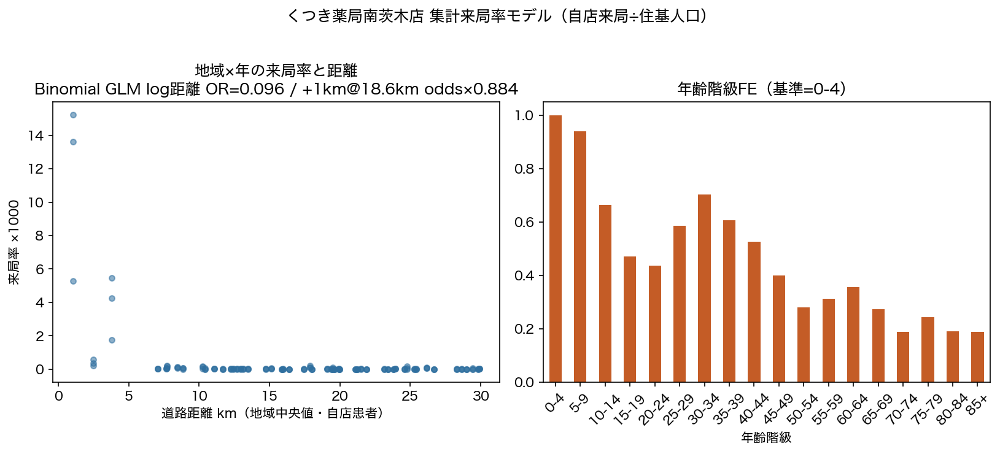
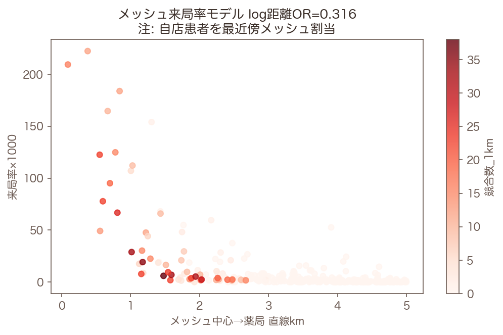
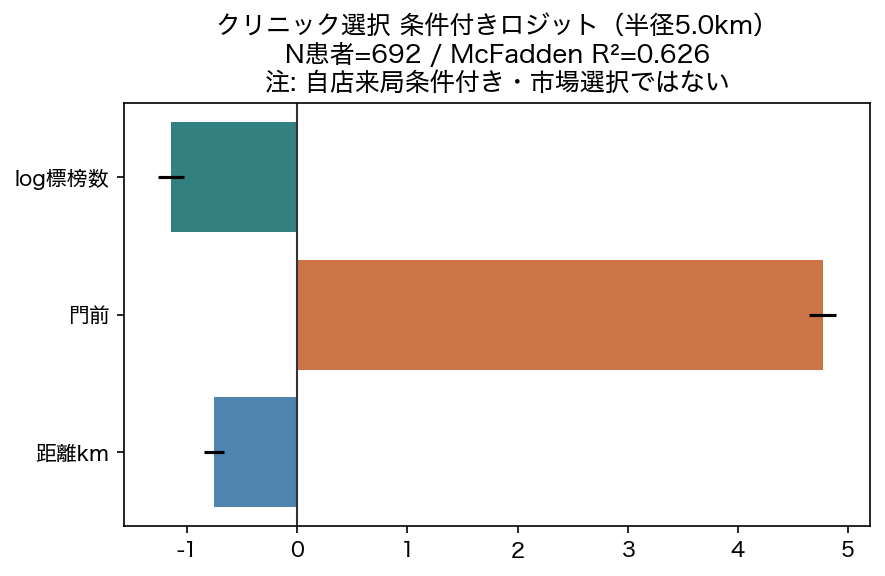
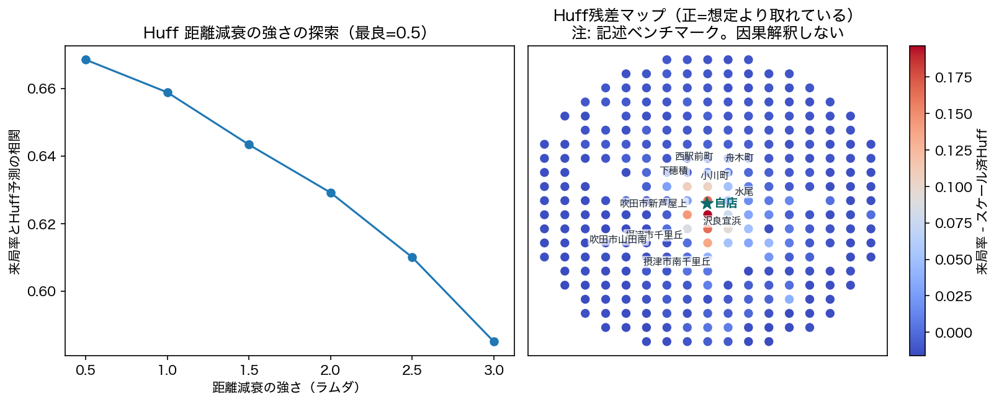
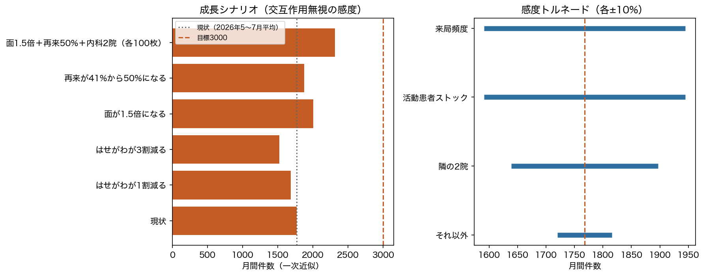

# Phase 3: 来局率モデルと Pharmacy Choice Rate

## わかったこと3点

1. **距離は来局率を強く規定する。** 集計Binomial GLMで log(道路距離) のOR=0.096。中央距離18.6kmで+1kmすると選択オッズが約×0.884（相関・条件付き関連）。
2. **クリニック選択でも距離・門前が効く（自店条件付き）。** 条件付きロジット N=692 / McFadden R²=0.626。これは市場全体の選択率ではない。
3. **今の施策をどれだけ強めても、この延長線上では3,000枚に届かない。** 現状（2026年5〜7月平均）1,768枚に対し、シナリオの最大は2,312枚（面1.5倍＋再来50%＋内科2院（各100枚））。（他固定の粗い必要条件）。届くには新しい処方元（クリニック）の獲得が必要。

## わからなかったこと3点

1. 真の薬局選択率（競合の実売・クリニック総発行数が未知）。
2. Huffのλ・魅力度は代理変数のみで識別が弱い。
3. 年齢は2026-07-31固定のまま年次比較している点のバイアス。

## 次に必要なデータ

- クリニック総処方箋発行数、競合規模、他店舗、イベント年表（優先度A）

---

## 6.1 集計来局率モデル（主分析）



- サンプル: 地域×年齢×年、道路距離≤30km かつ距離観測あり、N行=2,808 / 地域数=52
- モデル: Binomial GLM（var_weights=人口）、年齢FE・年FE、HC1
- AIC=116662.8
- 受療率: 全国・外来・年齢別（大阪府最新年は総数のみのため）（年齢構成の需要差を分離する目的）
- 競合は距離と共線のため地域モデルから除外し、メッシュモデルで評価

> 注: 来局率 = 自店ユニーク来局 / 住基人口。非来局を外部選択肢とみなした集計近似。係数は因果ではない。



メッシュ版 log距離OR=0.316

---

## 6.2 クリニック選択（条件付きロジット）



- 半径5.0km / 平均選択肢数≈177.8
- β距離=-0.758, β門前=4.768, β log標榜=-1.146

> **選択バイアス:** 推定対象は「最終的に自店に来た患者」のクリニック選択。一般人口のクリニック選択ではない。

---

## 6.3 Huff（記述ベンチマーク）



- 最良λ=0.5 / corr=0.669
- 残差マップは「想定より取れている／取れていない」メッシュの記述用。パラメータの因果解釈はしない。

---

## 6.4 Growth Engine 分解とシナリオ



```
                   シナリオ      予測月間件数   対ベース倍率  目標3,000到達                    注記
                     現状 1768.000000 1.000000      False               直近3か月平均
              はせがわが1割減る 1686.899286 0.954129      False 2院依存のリスク。1院の1割で店全体が動く
              はせがわが3割減る 1524.697857 0.862386      False       医師交代・移転などの最悪ケース
              面が1.5倍になる 2006.223656 1.134742      False         2院以外の医院からの処方箋
         再来が41%から50%になる 1874.080000 1.060000      False      初回患者のうち戻る人が増える概算
面1.5倍＋再来50%＋内科2院（各100枚） 2312.303656 1.307864      False        全部やっても目標との差が残る
```

依頼書の商圏人口×クリニック選択率×薬局選択率×継続率は、本分解の「人口×来局率×頻度」に対応づける（薬局選択率は集計来局率に吸収）。

---

## サンプル定義・限界

1. 自店来局のみ。市場シェア分母なし
2. 距離は自店患者の地域中央値（生態学的）
3. 受療率は大阪府外来・最新調査年の接続（推計接続）
4. 係数は因果効果ではない
